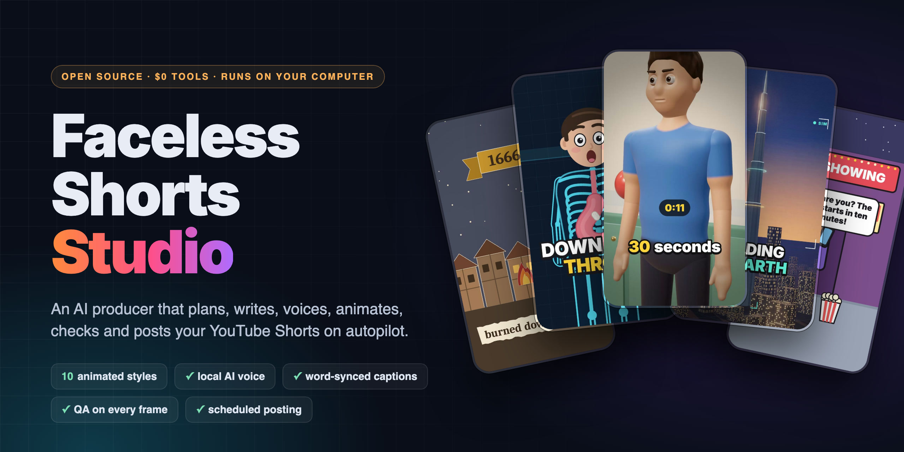
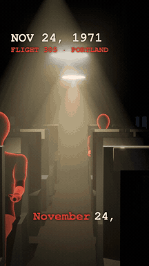
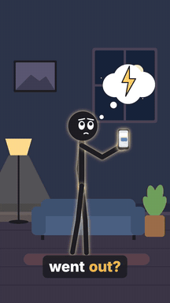
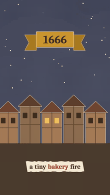
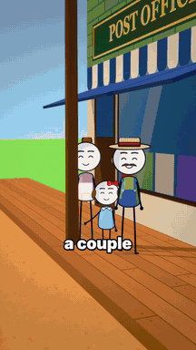
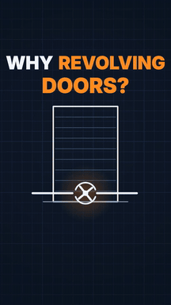
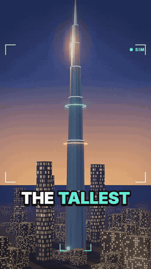
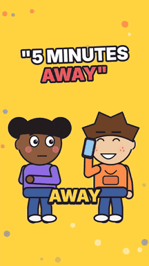
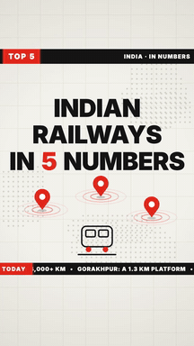
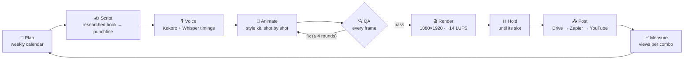

<p align="center">
  
</p>

<p align="center">
  <b>Run a faceless YouTube Shorts channel on autopilot, from your own computer, with free tools.</b><br>
  An AI agent researches and writes each Short, voices it with a local AI voice, animates it in code, checks every frame,<br>
  renders a 1080×1920 MP4 and posts it at your time slots. No stock footage, no AI-video credits, no subscriptions.
</p>

<p align="center">
  
  
  
  
  
  
</p>

<p align="center">
  <a href="#-quick-start">Quick start</a> ·
  <a href="#-ten-styles">Styles</a> ·
  <a href="#%EF%B8%8F-how-it-works">How it works</a> ·
  <a href="#%EF%B8%8F-autopilot">Autopilot</a> ·
  <a href="#-whats-in-the-box">What's in the box</a> ·
  <a href="handover.md"><b>The full guide</b></a>
</p>

---

## ✨ What you get

| | |
|---|---|
| 🧠 **An AI producer** | Claude picks a format and style for each topic, researches it (2+ sources per claim), writes a 45-58 s script with a one-line hook and a comment question. |
| 🎙️ **A free local voice** | Kokoro-82M narrates on your machine; Whisper times every word so captions land exactly on it. |
| 🎨 **10 animated styles, all in code** | 3D explainers, x-ray diagrams, cut-paper history, stick figures, cartoons, a news desk… drawn by three.js / canvas, captured by Chrome, encoded by ffmpeg. |
| 🔍 **QA on every frame** | Contact sheets of the whole video are read before anything ships. A Short that fails QA can't be held, uploaded or posted. |
| 🗓️ **A content calendar** | A planner fills your posting slots weeks ahead with two topic options each; you tick one in Notion (optional) or let it choose. |
| 📤 **Hands-off posting** | Finished Shorts go to a private Google Drive copy, then to YouTube through Zapier, only inside your posting window, and the channel name is checked after each upload. |
| 📈 **It learns** | Views per format × style feed a weekly mixing rule: more of what works, some room to test. |
| 🎬 **Bonus: film edits** | A second engine cuts 9:16 edits of public-domain films with original music. |

## 🚀 Quick start

**1. Get the studio** (clone into your home folder, not into an iCloud/OneDrive-synced folder):

```bash
git clone https://github.com/sunny-ctrl-alt-del/faceless-shorts-studio.git ~/shorts-studio
```

**2. Install** (checks your tools, installs the animation skill, downloads the voice + caption models, ~0.9 GB):

```bash
cd ~/shorts-studio && bash install.sh
```

> Missing Node, ffmpeg, Chrome or Python? `bash install.sh --install-tools` installs them with Homebrew, apt or winget.
> `bash install.sh --check` only reports and changes nothing.

**3. Hand it to the AI.** Open **Claude Code** in `~/shorts-studio` (Claude desktop app → *Code* tab, or `claude` in a
terminal) and say:

```text
Set up this studio for my channel about <your niche>
```

It reads [`CLAUDE.md`](CLAUDE.md) and [`handover.md`](handover.md), asks you one question (create only, post now, schedule, or
full autopilot) and walks you through the accounts that need a human. Want to see it work first?

```text
Make a Deep Dive 3D short: what happens if you crack your knuckles?
```

## 🎬 Ten styles

Every style ships with a style guide, a style sheet and a complete example project that renders as-is.

<table>
  <tr>
    <td align="center" width="20%"><br><b>Deep Dive 3D</b><br><sub>“What happens if…?” body &amp; science</sub></td>
    <td align="center" width="20%"><br><b>Night File 3D</b><br><sub>mysteries &amp; true crime</sub></td>
    <td align="center" width="20%"><br><b>Inside Out</b><br><sub>flat 2D x-ray explainers</sub></td>
    <td align="center" width="20%"><br><b>Stick Story</b><br><sub>“What would you do if…?”</sub></td>
    <td align="center" width="20%"><br><b>Paper Atlas</b><br><sub>history in cut paper &amp; maps</sub></td>
  </tr>
  <tr>
    <td align="center"><br><b>Tall Tale 3D</b><br><sub>funny true stories</sub></td>
    <td align="center"><br><b>Kinetic Diagram</b><br><sub>how it really works</sub></td>
    <td align="center"><br><b>Sim HUD 3D</b><br><sub>“the next 60 seconds”</sub></td>
    <td align="center"><br><b>Doodle Cartoon</b><br><sub>relatable character skits</sub></td>
    <td align="center"><br><b>News Desk</b><br><sub>today's top 5, on newsprint</sub></td>
  </tr>
</table>

<sub>Previews are 4-second self-test clips (`skill/faceless-shorts/scripts/selftest.sh`), shrunk to GIF. Real Shorts run 45-58 s with sound, music and effects.</sub>

## ⚙️ How it works



- **Engine A, the [Faceless Shorts skill](skill/faceless-shorts/)**: `script.json` → local voice → word timings → shots drawn
  in code, each cut and caption on its word → procedural sound + music → headless Chrome captures every frame → ffmpeg.
- **Engine B, the [film editor](tools/edit/)**: 9:16 edits of public-domain / CC BY films with grade, slow motion, glowing
  captions and original music.
- **The studio layer, [`tools/`](tools/)**: one entry point (`pipeline.sh`) for every step, so permissions can allow
  exactly one script; the planner, slot picker, QA gate, Drive hand-off and stats.
- **The brain**: Claude, following [`RUNBOOK.md`](RUNBOOK.md), started by scheduled tasks. It writes and checks; the
  tools do the deterministic work. Every step is a checkpoint, so an interrupted Short resumes where it stopped.

## 🗓️ Autopilot

Two scheduled tasks in the Claude desktop app run the whole channel, for any number of posting slots:

| task | runs | does |
|---|---|---|
| [`tasks/build.md`](tasks/build.md) | hourly | picks the next slot, builds **one** Short end to end, holds it for its time. Never posts. |
| [`tasks/post.md`](tasks/post.md) | every 30 min, 06:00-22:30 | posts every due, QA-passed Short; checks it landed on the right channel |
| [`tasks/weekly-planner.md`](tasks/weekly-planner.md) | Sundays | reads results, tops up ideas, extends the calendar 3 weeks |
| [`tasks/on-demand.md`](tasks/on-demand.md) | when you ask | one extra Short from a brief |

> **Publishing budget:** each Short costs 4 Zapier tasks. Zapier's free plan (100 tasks/month) covers about 25 Shorts a
> month; a free [Pipedream](tools/pipedream/) route is included for more. Details in [handover.md §4.4](handover.md#44-publishing-google-drive--zapier-no-public-links).

## 🛡️ Rules baked in

- **Copyright-safe by design**: no downloaded footage, clips, stills, music or characters. Everything is drawn, voiced
  and scored by the studio; film edits only use verified public-domain or CC BY films.
- **Never copies other channels**: reference channels were studied for *format* only (length, pace, cuts, loudness).
- **Nothing posts without passing QA**, nothing posts at night, and a Short posted to the wrong channel stops all posting.
- **Phone-safe layout**: nothing important under the YouTube buttons or captions overlay.
- **Private by default**: the video file is never made public; no links are shared; secrets live in git-ignored `config/`.

## 📦 What's in the box

```text
shorts-studio/
├── README.md               ← you are here
├── handover.md             ← THE guide: system map, rules, setup, production, automation, lessons + a map of every file
├── CLAUDE.md               ← auto-loaded by Claude Code: "you are the producer, start here"
├── install.sh              ← one-command setup (safe to re-run)
├── RUNBOOK.md              ← the exact procedure every scheduled run follows
├── channels.example.json   ← your channel: niche, slots, voice, format × style combos
├── STUDIO.example.md       ← decisions + lessons log
├── tasks/                  ← scheduled-task prompts (build · post · weekly planner · on demand)
├── tools/                  ← pipeline.sh + planner, slot picker, thumbnails, stats, film editor, Pipedream step
├── ideas/                  ← format × style matrix and the idea-pool shape
├── references/             ← thumbnail rules, public-domain film whitelist
├── skill/faceless-shorts/  ← Engine A: the animation skill (10 styles, each with a working example)
└── docs/assets/            ← the images on this page
```

Every file is explained in [handover.md → File map](handover.md#file-map-every-file-in-this-repository).

## 🧰 Requirements

| | |
|---|---|
| **Computer** | macOS (Apple silicon is fastest), Windows (Git Bash) or Linux · 10 GB free disk |
| **Tools** (free) | Node.js 22+ · ffmpeg · Google Chrome · Python 3.10+ (or uv) · git · yt-dlp (optional) |
| **AI** | [Claude Code](https://claude.com/claude-code) (the Claude desktop app's *Code* tab), with a Claude plan that covers your daily volume |
| **To post** (optional) | Google Drive for Desktop + a Zapier account with YouTube connected · Notion (optional calendar + tracker) |

## ❓ FAQ

<details>
<summary><b>Do I need to know how to code?</b></summary>
<br>No. You talk to Claude; it runs the commands, writes the scripts and builds the animation. You approve installs and
sign in to accounts.
</details>

<details>
<summary><b>Does it really cost $0?</b></summary>
<br>The tools do: every model and library runs locally, and posting fits Zapier's or Pipedream's free tiers at a modest
rate. You need a Claude plan for the AI itself, and higher posting volumes may need a paid automation plan.
</details>

<details>
<summary><b>Is this "reused content" in YouTube's eyes?</b></summary>
<br>No footage is reused: every frame is drawn by code from an original script, with an original voice-over, music and sound.
That is the opposite of a compilation channel. Film edits stick to verified public-domain or CC BY films.
</details>

<details>
<summary><b>Can it run more than one channel?</b></summary>
<br>Yes. Add an entry per channel to <code>channels.json</code>, each with its own niche, slots, voice and its own YouTube
connection. The same two tasks serve all of them (<a href="handover.md#11-more-channels-later">handover.md §11</a>).
</details>

<details>
<summary><b>Does my computer have to stay on?</b></summary>
<br>For autopilot, yes: the Claude desktop app open and the computer awake and plugged in. A Short that was interrupted
resumes on the next hourly run; a slot more than 6 hours late is skipped and recorded.
</details>

<details>
<summary><b>How do I add my own style?</b></summary>
<br>Copy a style folder in <code>skill/faceless-shorts/styles/</code>, change its kit in <code>src/core/</code> and its
<code>STYLE.md</code>, then run <code>selftest.sh</code>. Ask Claude to do it from a description or a reference image.
</details>

## 📜 License

[MIT](LICENSE) for the studio's code, stories, drawings and sound. Bundled fonts and libraries keep their own licenses:
see [THIRD-PARTY.md](THIRD-PARTY.md).

<p align="center"><sub>Made with Claude Code · every frame drawn in code</sub></p>
